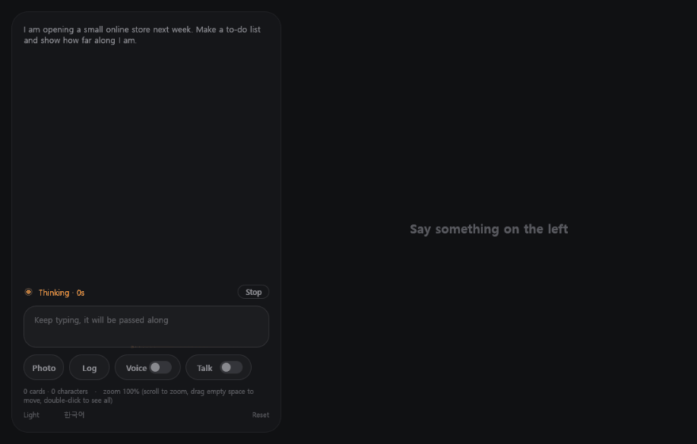
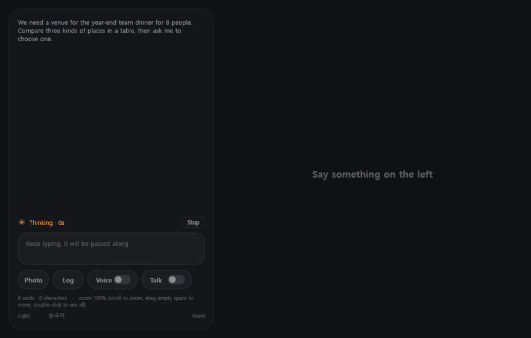
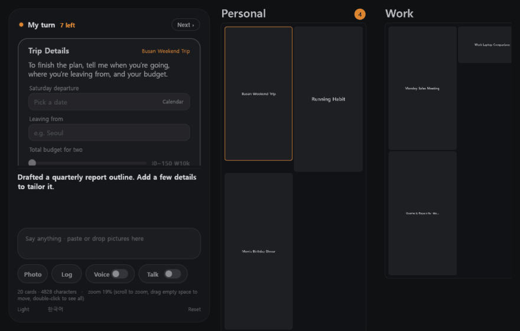
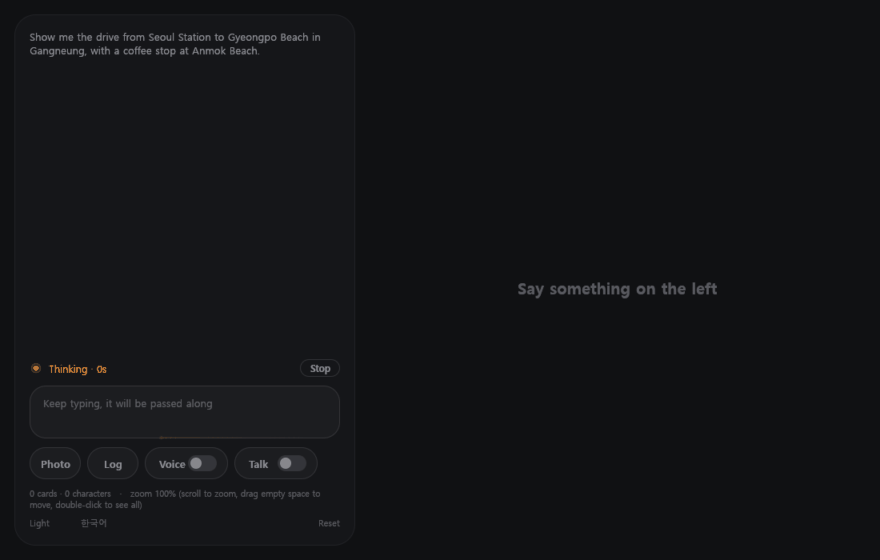
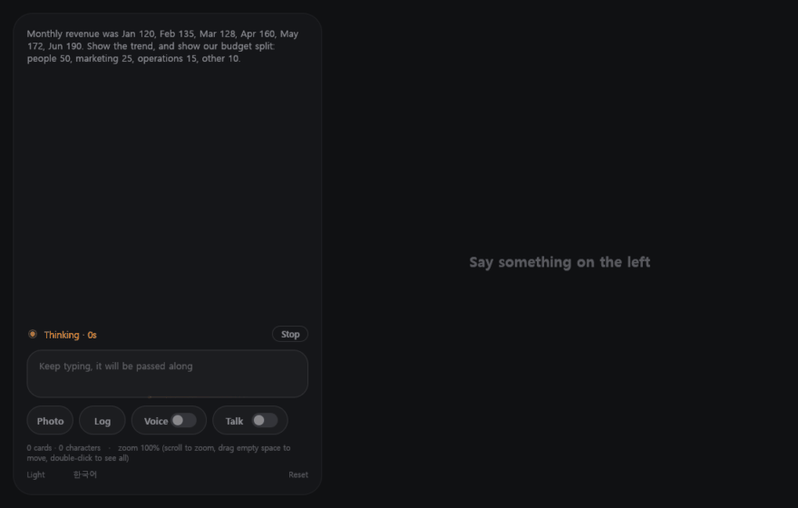

# ALI

**Adaptive Live Interface** · [English](README.md)

> 글자로 가득 찬 화면은 AI를 쓰는 가장 나쁜 방법이다.

인류는 놀라운 엔진을 발명해 놓고, 그것을 나무 바퀴 달린 마차에 얹었다. 엔진은 AI이고, 마차는 글자로 가득 찬 채팅창이다.

AI의 답은 매번 긴 글로 쏟아진다. 대부분은 읽히지 않는다. 사람끼리 글을 주고받으려고 만든 채팅창이, 글쓰기보다 훨씬 많은 일을 할 수 있는 기계와 일하는 자리가 되어 버렸다.

사람들은 이미 Jira, monday.com, Asana, Notion, Trello 같은 훌륭한 PM 도구와 협업 도구를 수없이 만들었다. 그런데 정작 AI 앞에서는 모두가 다시 글자만 쓰고 있다. 그렇다고 기존의 도구를 AI와의 창구로 쓰기에는 너무 복잡하고, 기능이 너무 넓게 퍼져 있다.

사람들에게 필요한 것은 한곳이다. 모든 대화와 모든 주제가 거기에 있고, 텍스트의 쓰나미 대신 실제로 필요한 정보가 보기 좋게 다듬어져서, 말하는 대로 바뀌는 실시간 적응형 인터페이스.

ALI가 그 한곳이다. 필요한 것을 말하면 AI가 화면을 직접 짠다. 일정은 시간표로, 여행은 경로로, 선택은 눌러서 고르는 카드로 보여 준다.

세상에 없던 도구라서 새로 만들었다. 이것으로 모두가 덜 지치고 더 많은 것을 해내기를 바란다.

## 무엇이 다른가

**화면이 곧 답이다.** AI는 글을 써 보내지 않는다. 카드가 놓인 판을 한 줄씩 고치고, 사용자는 판이 바뀌는 것을 본다. 같은 일을 다시 물으면 새 글이 쌓이지 않고 그 카드가 바뀐다. 판은 대화 기록이 아니라 지금의 상태다.

**할 일이 나를 찾아온다.** AI가 결정이나 값을 받아야 하면, 그 카드 하나가 대화창 옆의 "내 차례" 자리로 온다. 판은 그 일이 속한 자리로 옮겨 가서 주변 상황을 함께 보여 준다. 답하면 다음 일이 온다. 무엇이 나를 기다리는지 찾아다니지 않는다.

**모든 일이 판 하나에 있다.** 채팅방도 스레드도 없다. 주제들이 한 장의 판에 놓이고, AI가 분류를 만들고 이름을 고치고 합치며 스스로 정리한다. 멀리서 전체를 보고, 당겨서 카드 하나를 본다. 끝난 일은 보관함으로 내려가고, 다시 말을 꺼내면 돌아온다.

**직접 그린다.** 실제 거리와 소요 시간이 담긴 경로, 꺾은선·막대·도넛 차트, 흐름도와 배치도, 그림. AI가 가장 빨리 읽히는 형태를 고른다.

**기억한다.** 턴이 끝날 때마다 남겨 둘 사실을 골라 적는다. 방금 한 말과 관련 있는 옛 대화는 찾아서 함께 본다. 모든 것은 옵시디언으로 열 수 있는 마크다운 폴더에 남는다.

**일을 한다.** 명령을 실행하고, 파일을 읽고 고치고, 웹을 찾고, 판 위의 브라우저를 다룬다. 오래 걸리는 일은 작업 지시서를 써서 작업자들에게 맡기고, 작업자들이 동시에 일하는 동안 대화는 계속된다.

**말로도 한다.** 타자 대신 말하고 듣는다. AI가 말하는 중에 끼어들 수 있다.

## 써 보기

아무것도 없이 둘러볼 수 있다. 키가 없으면 준비된 장면을 재생하는 데모로 열리고, 화면에 데모라고 표시된다. 실제로 쓰려면 [Claude API 키](https://console.anthropic.com/settings/keys)가 필요하다. 요금은 본인 계정에 청구된다. 키는 환경 변수 `ANTHROPIC_API_KEY`로 줄 수도 있다.

**Claude Code를 엔진으로 쓸 수도 있다.** [Claude Code](https://claude.com/claude-code)가 깔려 있으면 같은 창에서 고를 수 있고, ALI는 API를 직접 부르는 대신 턴마다 Claude Code에 맡긴다. Claude Code의 로그인, `CLAUDE.md`, 스킬, 훅, MCP 서버, 권한 설정이 그대로 적용되고 API 키는 필요 없다. 파일·명령·웹 작업은 Claude Code의 도구로 하고, ALI 자체 도구(경로 지도, 기억 노트, 판 읽기)는 ALI 안의 작은 로컬 MCP 서버로 내준다. 작업자와 기억 자동 정리는 API 키가 있어야 돈다. Claude Code가 자기 지시문을 함께 보내기 때문에 API 키 방식보다 턴당 토큰이 더 든다. `--permission-mode acceptEdits`나 `--model sonnet` 같은 Claude Code 옵션은 프로그램 폴더의 `claude-args.txt`에 적는다.

두 번째 키는 선택이다. [TypeSafe AI](https://typesafe.ai)의 Jev 키다. Jev는 글을 쓰지 않고 판단만 하는 작고 빠른 모델이다. 넣으면 말이 어느 주제에 속하는지 미리 고르고, 중요한 카드를 앞에 놓고, 겹치는 주제를 정리하고, 옛 대화에서 필요한 것만 골라 온다. 없어도 ALI는 그대로 동작한다. 두 키 모두 왼쪽 아래의 **키**에서 언제든 넣거나 바꿀 수 있다(환경 변수 `TYPESAFE_API_KEY`도 된다).

**Windows.** [Releases](https://github.com/fidenit/ALI/releases)에서 zip을 받아 풀고 `ali.exe`를 실행한다. 설치는 없다. 처음 켜면 키를 묻는 창이 뜬다. 건너뛰고 데모로 둘러봐도 된다.

**Mac.** 지금은 직접 빌드한다. `./run.sh pack`이 `portable/ALI/ALI.app`을 만든다. [개발자용 안내](docs/DEVELOPING.md)를 본다.

키, 판, 기억 보관함은 모두 프로그램 폴더 안에 있다. 폴더를 옮기면 전부 따라간다.

## 실행하기 전에 알아 둘 것

- **AI는 묻지 않고 행동한다.** 사용자의 컴퓨터에서 명령을 실행하고 파일을 고친다. 그렇게 쓰도록 만든 프로그램이다. 그래도 괜찮은 컴퓨터에서, 이 점을 알고 쓴다.
- **쓰는 만큼 돈이 든다.** 기본으로 가장 뛰어난 Claude 모델을 쓴다.
- **아직 초기다.** 한 사람이 매일 쓰고 있다. 한국어와 영어를 지원하고, 화면 구석에서 바꾼다. [다음에 할 일](docs/NEXT.md)을 본다.
- 경로 카드의 거리와 시간은 카카오맵에서 읽어 온다. 그래서 경로는 한국 안에서 동작한다.

## 개발자에게

Rust와 [egui](https://github.com/emilk/egui)로 만들었고, Claude API를 HTTP로 직접 부른다. 웹 화면은 없다. 모델은 판을 고치는 작은 줄 단위 언어를 내고, 줄이 도착하는 대로 반영된다. 그 판을 같은 언어로 다시 적은 것이 다음 턴에 모델이 보는 전부다.

빌드 방법, 코드의 구조, 새 카드 종류를 더하는 법은 [docs/DEVELOPING.md](docs/DEVELOPING.md)에 있다.

코드의 대부분은 AI(Claude)와 함께 썼다. 구상과 설계의 결정은 사람이 했다.

## 라이선스

[Apache License 2.0](LICENSE). 다시 배포할 때는 [NOTICE](NOTICE) 파일을 함께 둔다. "ALI"라는 이름은 파생 제품의 이름으로 쓸 수 없다.

---

**FIDENIT** · 세상을 위해.
