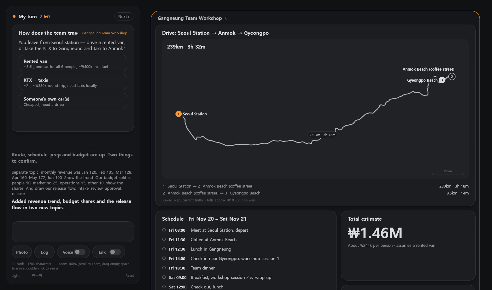
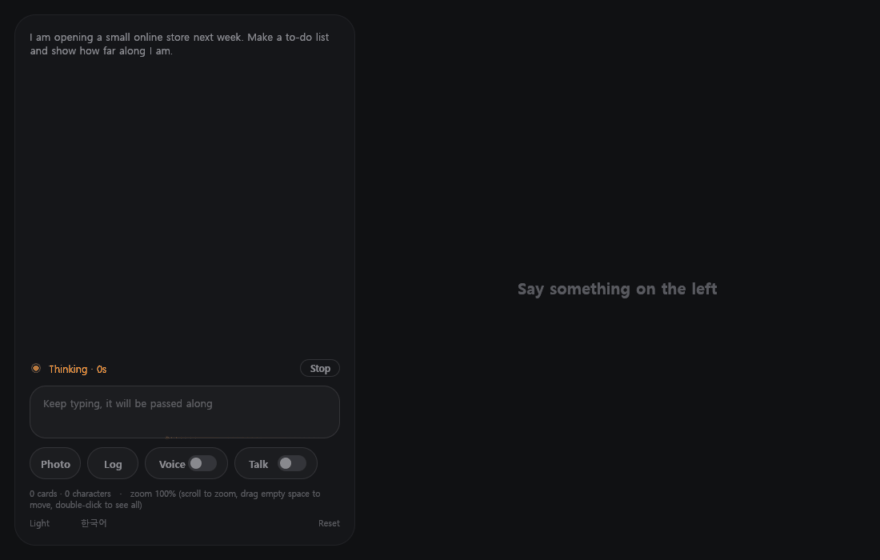
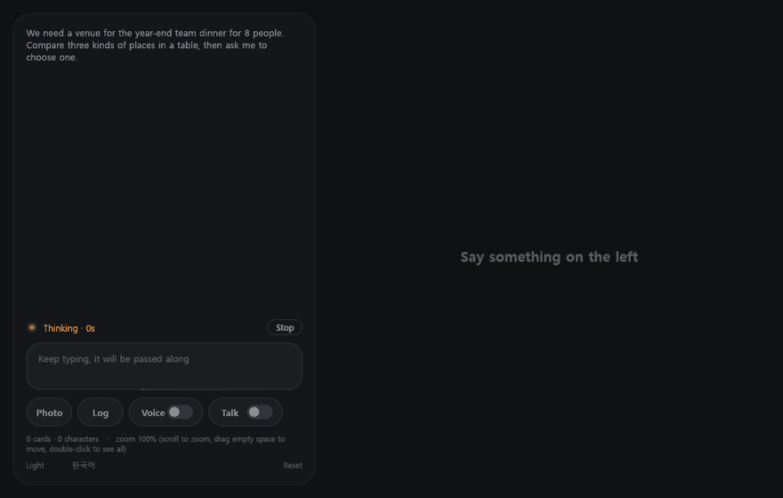
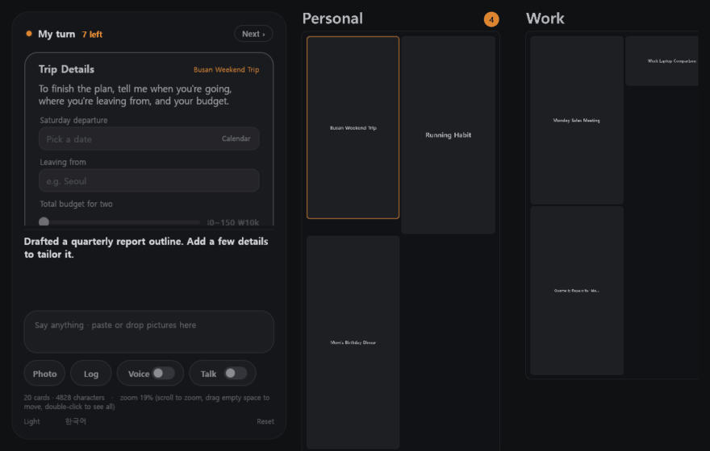
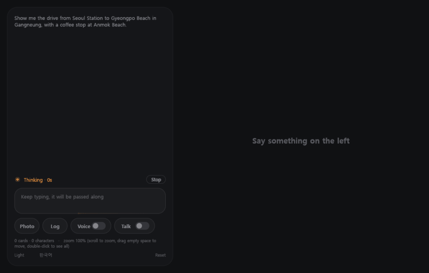
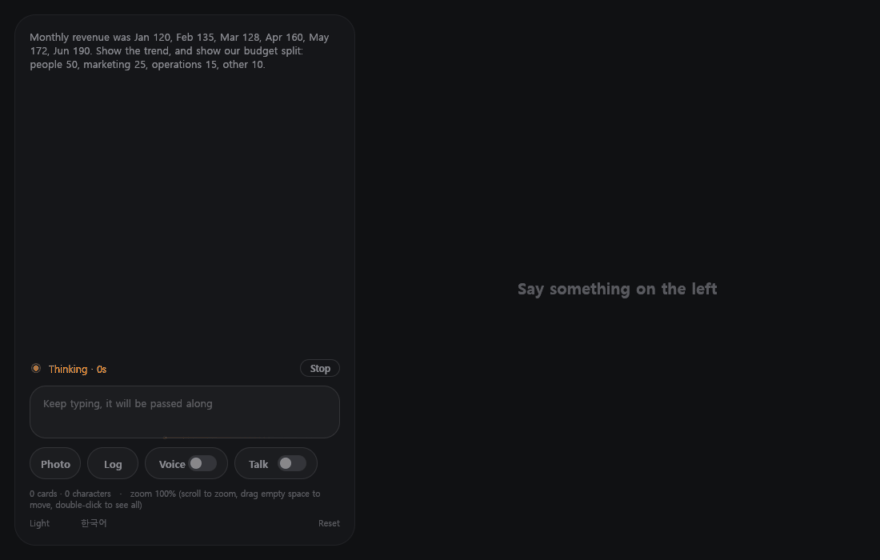

# ALI

**Adaptive Live Interface** · [한국어](README.ko.md)

> A screen full of text is the worst way to use AI.

We built an extraordinary engine and bolted it to a wooden cart.

Every answer comes back as a scroll of paragraphs. Most of it goes unread. The chat window, a tool made for people typing to each other, became the place where we work with a machine that can do far more than type.

We have already built many excellent project and collaboration tools. Yet with AI we went back to plain text. And those tools are too complex, with features spread too wide, to be the place where you talk to an AI.

What we want is one place. Every conversation and every topic lives there, shown as the information you actually need, shaped so it reads at a glance, in an interface that adapts as you speak. No tsunami of text.

ALI is that place. You say what you need, and the AI arranges the screen for you: a schedule as a timeline, a trip as a route, a choice as a card you tap.

Nothing like it existed, so we built it. We hope it makes working with AI less tiring and more productive for everyone.

## What is different

**The screen is the answer.** The AI does not write to you. It edits a board of cards, one line at a time, and you watch the board change. Ask about the same thing again and the same card updates. The board shows where things stand now. It is not a transcript.

**Work comes to you.** When the AI needs a decision or a value from you, that one card moves to the "my turn" slot beside the conversation, and the board slides to the part of the work it belongs to. Answer it and the next one arrives. You do not go looking for what is waiting on you.

**One board for everything.** No chat rooms and no threads. Topics sit on a single canvas, grouped into areas the AI creates, renames and merges as your work grows. Zoom out to see everything, zoom in to one card. Finished work is shelved and comes back when you mention it.

**It draws.** Routes with real distances and travel times, line, bar and donut charts, flows and layouts, pictures. The AI picks the form that reads fastest.

**It remembers.** Facts worth keeping are picked out after every turn. Old conversations related to what you just said are found and brought along. Everything is stored as plain Markdown in a folder you can open in Obsidian.

**It does the work.** It runs commands, reads and edits files, searches the web and drives a browser on the board. Longer jobs are written up as a work order and handed to workers that run in parallel while you keep talking.

**You can talk to it.** Speak and listen instead of typing. Interrupt it while it is speaking.

## Try it

You need a [Claude API key](https://console.anthropic.com/). Usage is billed to your own account.

**Windows.** Download the zip from [Releases](https://github.com/fidenit/ALI/releases), unpack it and run `ali.exe`. There is no installer. The first screen asks for your key. The build in Releases can be older than `main`.

**Mac.** Build it yourself for now: `./run.sh pack` creates `portable/ALI/ALI.app`. See [DEVELOPING](docs/DEVELOPING.md).

Keys, the board and the memory vault live in the program's own folder. Move the folder and everything moves with it.

## Know before you run

- **The AI acts without asking.** It runs commands and changes files on your computer on its own. ALI was built to be used that way. Run it knowing this, on a machine where that is acceptable.
- **It costs money as you use it.** By default it uses the most capable Claude model.
- **It is early.** One person uses it daily. Korean and English, switched in the corner. See [what is next](docs/NEXT.md).
- Distances and times on route cards are read from Kakao Map, so routes work in South Korea.

## For developers

Rust, [egui](https://github.com/emilk/egui), and the Claude API called directly over HTTP. No web front end. The model's output is a small line-based language for editing the board, applied as each line arrives; the board, written back in the same language, is what the model sees on the next turn.

Build steps, the layout of the code and how to add a new kind of card are in [docs/DEVELOPING.md](docs/DEVELOPING.md) (Korean).

Most of the code was written together with AI (Claude). The idea and the design decisions are human.

## License

[Apache License 2.0](LICENSE). Keep the [NOTICE](NOTICE) file when you redistribute. The name "ALI" may not be used as the name of a derived product.

---

**FIDENIT** · for the world.
